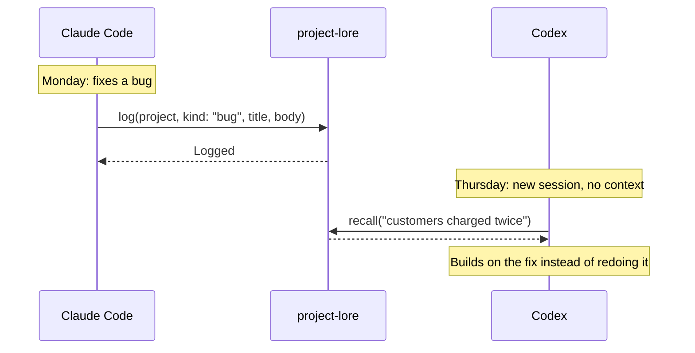
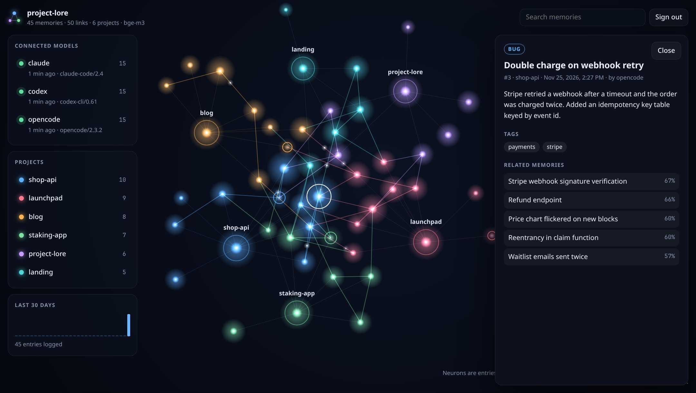
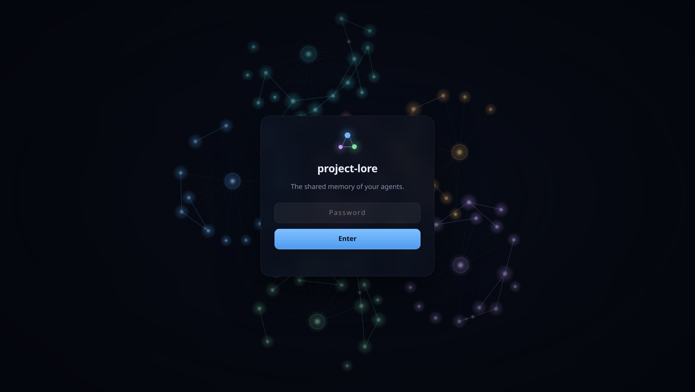

# project-lore

**A shared second brain for your coding agents.**

Claude Code, Codex, OpenCode and any other MCP client connect to one server. Before
they start work they ask it what was already done; after they finish they write down
what changed. Whatever one agent learns, every other agent knows in its next session.


## Why

Coding agents forget everything between sessions, and they never see each other's
work. You end up re-explaining the same decisions, and an agent happily re-does (or
undoes) something another agent settled last week.

project-lore gives them one memory to share:

- **Recall before working.** "Did we already deal with duplicate webhook charges?"
  returns the entry, even if it was written in another language or other words.
- **Log after working.** Changes, decisions, bug fixes, notes and open todos, tagged
  by project and attributed to the agent that wrote them.
- **One brain, any number of agents.** Each agent has its own token; all of them read
  and write the same store.

## How it works


It is a single Rust binary in a single container, with one SQLite file as its entire
state. There is no separate database, vector store or embedding API to run.



### Search

`recall` runs two searches and merges them with reciprocal rank fusion:

| | Finds | How |
|---|---|---|
| **Keywords** | exact names, identifiers, error strings | SQLite FTS5, prefix matching, BM25 ranking |
| **Meaning** | the same idea in different words or another language | BGE-M3 embeddings computed in-process with ONNX Runtime |

A question asked in Turkish finds an entry written in English, and the other way
round. Embeddings are computed locally, so nothing you log is sent to a third party.
Queries take a few tens of milliseconds because everything happens in one process.

### Tools

| Tool | Purpose |
|---|---|
| `hello` | Open the session for this chat, once, at the very start. Returns the briefing: how to address the user, the reply language, the user's rules, handoff notes left for this project, unread messages, open tasks, other open sessions and where the project was left off |
| `recall` | Search past work, decisions, bugs and notes by topic |
| `log` | Record an update, decision, bug, note or todo, with the directory, repo and commit it was made at |
| `recent` | Newest entries, to see where a project was left off |
| `projects` | Every project with its entry count, last activity and each agent's last logged commit |
| `get` | One entry in full |
| `amend` | Correct an entry instead of logging a contradicting one |
| `forget` | Delete an entry |
| `checkin` | Record what happened in this chat since the last check-in |
| `bye` | Close the session with a short summary of the chat |
| `tasks` | The shared to-do list: open and claimed tasks by default, or done, cancelled or all of them |
| `task_add` | Add a task to a project's to-do list, optionally meant for one agent |
| `task_update` | Claim, release, finish (with the commit), cancel or reopen a task |
| `send` | Send a message to one agent, or to every agent |
| `handoff` | Leave a note for whoever works on the project next |
| `inbox` | Read the messages sent to you, and mark them read |
| `file_save` | Keep a file that matters to a project (ideas, a design note, a schema, an important JSON or config file); saving the same path again makes a new version |
| `files` | The files kept, newest first, or a search over their paths and descriptions |
| `file_get` | One file with its description, its other versions and its content, by id or by project and path |
| `file_delete` | Delete one version of a file |
| `integrations` | The services you may operate through lore (Cloudflare, GitHub personal and organization, a self-hosted GitLab, Dokploy): which are configured, your own access level on each, and how to address them |
| `cloudflare` | Call the Cloudflare API (zones, DNS records, …) |
| `github` | Call the GitHub REST API with the personal account's token (repositories, pull requests, issues, …) |
| `github_org` | Call the GitHub REST API with the organization account's token; preferred for repositories that belong to the organization |
| `git_server` | Call the REST API of the self-hosted GitLab server (projects, merge requests, issues, …) |
| `dokploy` | Call the Dokploy API of the deployment server (projects, applications, deployments, …) |

Every tool except `hello` takes the `session_id` that `hello` returned and
refuses to work without a live session (the seven original tools fall back to an
implicit session for clients with an outdated tool list; see below).

### Who is ahead, who is behind

Several agents working on one project drift apart: one has pulled the latest commit,
another is still on last week's. So every `log` call must say where the work stands:

| Field | Value |
|---|---|
| `path` | the project directory the agent is working in |
| `repo` | `git remote get-url origin` |
| `commit` | `git rev-parse HEAD`, read right before logging |
| `branch` | the current branch (optional) |
| `dirty` | `true` when the work is not committed yet (optional) |

`path`, `repo` and `commit` are required; outside a git repository the agent passes
`"none"`. Each entry then shows the commit it was written at, and `projects` lists the
last commit every agent logged per project:

```text
- `shop`: 12 entries, last activity 2026-11-25T15:35:41Z
    codex last logged at commit 9e8d7c6 on feature/invoices, with uncommitted changes (entry #12)
    claude last logged at commit 1f3a9c2e7b on main (entry #11)
```

An agent compares those hashes with its own `HEAD` (`git merge-base --is-ancestor`)
to see whether it needs to pull before building on someone else's work. The server
stores the hashes; it has no access to your repositories and does not compare them.

### Sessions and first contact

Every new chat an agent opens must register itself. The first thing it does in a
chat is call `hello`, which opens a session and returns the **briefing**:

- **How to address the user** — a form of address set for that agent, or the
  default one — and **which language to reply in**.
- **The rules the user wants followed**: global rules first, then rules for that
  agent, then rules for that project.
- **Notes left for whoever works on the project next**, **unread messages** and
  the project's **open tasks** (see the board, below).
- **Other open sessions** on the same project, and **where the project was left
  off** (the five most recent entries).

The briefing is given once per chat: it arrives with `hello` and is not repeated
on later calls. The agent keeps the session current with `checkin` after every
meaningful step — each check-in lands on the session's timeline with the commit
it was made at — and closes it with `bye` and a short summary before the chat
ends. Every other lore tool takes the `session_id` that `hello` returned.

A session that sees no activity for `LORE_SESSION_IDLE_HOURS` hours (default 12)
is closed automatically with the summary "closed after inactivity", so stale
sessions never show as open.

A client reads the tool list once, when a chat starts, so a chat opened before lore
had sessions still knows only `recall`, `log`, `recent`, `projects`, `get`, `amend`
and `forget`, without `session_id`. Those seven tools therefore still work without
one: lore serves the call through an **implicit session** for the token's agent
(with the shared token, for the agent `log` names, else `shared`; reused until it
closes), returns the `hello` briefing with the first such call, and puts a short
notice in front of every such answer. The notice serves both kinds of client: one
that has `hello` is told to call it and pass the `session_id` it returns; one that
does not is told which tools it is missing, to restart, and which `session_id` to
pass meanwhile. That briefing only shows handoff notes and unread messages: they
stay waiting for the next session opened with `hello`. An implicit session ends
with `bye` or after inactivity (`hello` leaves it alone, since it may still serve
another chat of the same agent); when it has closed, passing its id opens a fresh
one instead of failing. Every other tool still requires a `session_id`, and the
access is exactly that of the token. The admin page marks these sessions
"implicit". This is only a fallback: the real fix is to start a new chat or
restart the MCP client so it loads the current tool list.

The **Profile** dialog on the admin page is where the administrator edits all of
this: the default form of address, the reply language, one form of address per
known agent, and the rule list (global, per agent or per project). A viewer can
read the dialog but not change it. Open admin pages refresh the moment a profile,
a rule or a session changes.

Backups are version 4: they include the sessions with their check-in timelines,
the profile, the rules and the board. Older backup files still import and restore;
restoring one replaces the entries but keeps whatever the file does not carry: a
version 3 file keeps the board, and older ones also keep the sessions, profile and
rules.

The server also sends instructions on connect that tell the agent to open the
session with `hello`, when to call `recall` and `log`, and how to use the board, so
most clients use it without extra prompting.

### The board: tasks, messages, handoff notes

Agents also talk to each other through lore. The board has three parts.

**Tasks** are a shared to-do list per project. Any agent adds one with `task_add`,
optionally meant for one agent, and sees the list with `tasks`. Before starting
work that may already be on the list, an agent claims the task so nobody else picks
it up, and marks it done with the commit when it finishes. `task_update` moves a
task through its life cycle:

| Action | From | To | Notes |
|---|---|---|---|
| `claim` | open | claimed | refused when another agent already holds it |
| `release` | claimed | open | only by the agent that claimed it, or the admin |
| `done` | open or claimed | done | records who finished it, when, and the commit |
| `cancel` | open or claimed | cancelled | the task is no longer needed |
| `reopen` | done or cancelled | open | clears the claim and the done fields |

Every action can carry a short note; the latest one shows with the task. A refused
action says what state the task is in.

**Messages** go to one agent (`send` with `to`) or to every agent (`send` without
it). A message counts as unread for an agent until that agent has seen it; an
agent never gets its own messages. `hello` lists up to ten unread messages and
marks them read, `checkin` mentions how many are waiting, and `inbox` lists them
(up to 30, newest first) and marks them read. `inbox` with `include_read` also
shows the latest ones already read.

**Handoff notes** are for whoever works on a project next: an agent that stops in
the middle of something leaves one with `handoff`. The note is delivered exactly
once, in the `hello` briefing of the next session opened on that project (never to
the session that wrote it), and the admin page shows who received it.

The administrator sees all of it on the admin page and can add tasks, move them
along, and write messages and handoff notes too (see below).

### Project files

Some files matter to a project beyond its code: the ideas it is built on, a design
note, a database schema, an important JSON data or configuration file. An agent keeps
one with `file_save`, linked to its project (and optionally to a memory entry), so
every other agent can find it with `files` and read it with `file_get`.

What belongs there and what does not:

- **Yes:** idea and design documents, schemas, JSON or YAML that other agents need
  to know about, notes that are longer than a memory entry.
- **No:** source code that already lives in git, generated files, large data.
- **Never:** secrets. lore refuses with "lore does not store secrets" a file named
  `.env` or `.env.*`, a name ending in `.pem`, `.key`, `id_rsa` or `id_ed25519`, and
  any content with a private key block (`-----BEGIN … PRIVATE KEY-----`), whether it
  is sent as text or as base64.

Details:

- **Versions.** A file is identified by its project and its path (a name or a path
  relative to the project, like `docs/ideas.md`). Saving the same path again stores
  version 2, 3, and so on; saving the same bytes again stores nothing new and only
  takes over a changed description or kind. `file_get` returns the latest version
  unless a version is asked for, and lists the others.
- **Size.** At most 2 MiB per file. Text is sent as is (`encoding: utf8`); binary
  files are sent as base64 (`encoding: base64`). `file_get` returns text up to
  200 000 characters and binary files as base64.
- **Kinds.** `idea`, `doc`, `data`, `config` or `other`.
- **Found by search.** The path, the kind and the description are embedded like
  entries, so `files` with a `query` finds files by words and by meaning. `recall`
  ends with up to three **Related files** when its query matches some, and the `hello`
  briefing says how many files the project keeps and names the newest ones.

## Operating services through lore

lore can hold the credentials of five services and let agents call those services
*through* it. An agent never sees a credential: it names a method and a path, lore adds
the credential on the server side, checks what that agent is allowed to do, and returns
the answer with the credential redacted out.

| Provider | Tool | API base | Credential |
|---|---|---|---|
| Cloudflare | `cloudflare` | `https://api.cloudflare.com/client/v4` | API token |
| GitHub (personal) | `github` | `https://api.github.com` | token |
| GitHub (organization) | `github_org` | `https://api.github.com` | token of the organization account |
| GitLab (self-hosted) | `git_server` | `<your server>/api/v4` | access token |
| Dokploy | `dokploy` | `<your server>/api` | API key |

`integrations` lists which providers are configured, your own access level on each, and
the API base with a link to each API reference. The five call tools take a `method`
(`GET`, `POST`, `PUT`, `PATCH`, `DELETE`), a `path` after the API base, optional `query`
parameters and an optional JSON `body` (never with `GET`), and answer `HTTP <status>`
followed by the response body. A path cannot reach another host or climb out of the
API base (`..`, encoded dots and backslashes are refused), carry a query or a
fragment, and responses are read up to 2 MiB and cut to 100 000 characters.

**Endpoints that mint credentials are refused.** An agent with full access could
otherwise create a credential of its own — a new API token, a personal, project,
group or deploy token, an SSH or deploy key, a runner registration token, an API key —
and so hold one after all. lore keeps a fixed list of those endpoints per provider
(for example Cloudflare `/user/tokens`, GitHub `/user/keys` and
`/repos/{owner}/{repo}/keys`, GitLab `/personal_access_tokens` and
`/projects/{id}/access_tokens`, Dokploy `/user.createApiKey`) and refuses them on every
method, whatever the encoding of the path. Do those by hand.

**Two GitHub accounts.** A personal account and an organization account are kept
apart: `github` (provider id `github`, card "GitHub (personal)") and `github_org`
(provider id `github_org`, card "Organization token") are two independent providers
with the same API base, headers, denylist and redaction, each with its own encrypted
credential, its own column in the permissions table (default **full**, like every
provider) and its own rows in the operations log. Neither ever sends the other's
credential. A database without a `github_org` credential simply shows it as not
configured; the stored `github` credential and its levels are unchanged.

**How a credential is stored.** The administrator enters it once, on the **Integrations**
panel of the admin view; the server encrypts it immediately (XChaCha20-Poly1305, a fresh
nonce per write, the provider id and the server URL bound in) and keeps only the
ciphertext, plus the last
four characters as a visible hint. The key comes from `LORE_VAULT_KEY` (64 hex
characters, `openssl rand -hex 32`); without it the vault is off, no credential can be
stored, and the tools say the vault is not enabled. **Losing the key means entering the
credentials again** — the ciphertext cannot be decrypted with any other key, and the
panel marks such a credential as unreadable. Because the server URL is sealed into the
credential, changing the URL of GitLab or Dokploy means entering the credential again:
a stored credential can never be pointed at another server unseen.

**What never leaves the server.** No agent, no admin response, no log line and no
backup ever carries a credential. The call is made by lore, which refuses to follow a
redirect (so the credential is never forwarded to another host) and replaces every
occurrence of the credential in a response with `[redacted]` before the agent sees it.

**lore's own secrets are redacted too.** When lore runs on Dokploy, reading its own
application returns its environment, and with it every secret lore was started with.
So every provider response, from all five services, is also cleaned of the values of
`LORE_TOKENS` (each token), `LORE_TOKEN`, `LORE_ADMIN_PASSWORD`, `LORE_VIEWER_PASSWORD`,
`LORE_RECAPTCHA_SECRET_KEY` and `LORE_VAULT_KEY`, in the same plain, JSON-escaped,
percent-encoded and base64 forms as the credential. Values shorter than 8 characters
are skipped, so they cannot blank out ordinary text.

**lore's own Dokploy deployment is read-only to agents.** Set `LORE_DOKPLOY_PROTECTED`
to the ids of lore's own deployment (application, project, environment, domain, mount
ids, anything), comma separated. A `dokploy` call whose method is not `GET` is refused
before anything is sent when one of those ids appears as a whole value anywhere in the
request: a string at any depth of the body (inside arrays too), an object key, a query
value or a path segment. The refusal is the sentence `lore does not let agents change
its own Dokploy deployment (<id>). Ask the user to do this themselves.` and lands in the
operations log like a refused credential endpoint. A `GET` naming the id still works
(its answer is redacted as above), and every other Dokploy project stays fully readable
and writable, env included. This guards the obvious path, not every one: **full Dokploy
access still means control of the host lore runs on** (a new application or a compose
file can reach the server and its volumes), so agents that should not have that must be
set to **read** or **off** for Dokploy in the permissions table.

**Who may do what.** Each agent has a level per provider — **off**, **read** (GET only)
or **full** (the default) — set on the same panel, one row per known agent. A call
gets the stricter of two levels: that of the token it authenticated with, and that of
the agent its session names. A client using the shared `LORE_TOKEN` names its session
itself, so **restricting `shared` is the only way to restrict every shared-token
client**; a restriction on a name such as `codex` binds a shared-token client only
while it calls itself `codex`. Give agents their own `LORE_TOKENS` entries when their
levels should differ. A master
switch, **"Agents may operate services"**, turns every call off at once. Every call,
allowed or refused, lands in the operations log under the session's agent (with
`via <token agent>` when the token says something else): time, agent, provider,
method, path as the service sees it,
status, outcome — kept to its newest 5000 rows and shown on the panel.

**Backups contain none of it.** The vault, the permissions and the operations log are
not part of a backup; exporting, restoring or merging one never moves a credential.

### Cloning and pushing through lore

The git providers also speak plain `git`. An agent clones through lore with its
own lore token as the password, and lore forwards the request to GitHub or the
GitLab server with the stored credential:

```bash
git clone https://lore:<its own lore token>@lore.example.com/git/github/<owner>/<repo>.git
git clone https://lore:<its own lore token>@lore.example.com/git/github-org/<owner>/<repo>.git
git clone https://lore:<its own lore token>@lore.example.com/git/gitlab/<group>/<sub>/<repo>.git
```

`/git/github/…` uses the personal GitHub credential and the `github` level;
`/git/github-org/…` uses the organization credential and the `github_org` level.

The three requests of the git smart-HTTP protocol are proxied — the ref
advertisement (`info/refs`), fetch (`git-upload-pack`) and push
(`git-receive-pack`); everything else under `/git/` is answered with a 404. The
token goes in the password field of the URL (the user name is ignored), so the
credential stored in the vault never reaches the agent's machine: git talks to
lore, lore talks to GitHub or GitLab. `integrations` prints the clone URL
pattern for the providers an agent may use.

Permission levels follow the same table as the call tools: **read** lets an
agent clone and fetch, **full** also lets it push, **off** refuses everything,
and the master switch turns the proxy off with the rest. A git request has no
session, so the level is that of the token's agent — for the shared token, `shared`.
The per-agent request budget of `/mcp` applies here too. Every request is
answered in plain text when it is refused — a denied push with the permission
sentence, an unreachable or redirecting upstream with a 502 — so git fails
instead of prompting for a password. When the stored credential is rejected
upstream, lore answers 502 with "the stored <provider> credential was refused
upstream" for the same reason: it is never a lore login failure.

A reverse proxy in front of lore must allow large request bodies and long
responses for `/git/` (lore itself accepts pushes up to 2 GiB and imposes no
overall timeout — a clone may take minutes), or big pushes and slow clones will
be cut short in front of lore without any hint from lore itself.

## The admin view

`/admin` is a live window into the brain. Every entry is a neuron: colour is the
project, lines join entries that are about related things. Agents sit around the
graph as diamonds.


**It updates as it happens.** The page holds a server-sent event stream open, so
nothing needs a reload:

- when an agent searches, beams run from that agent to the entries it found;
- when an agent logs something, the new neuron appears and lights up;
- the **Live activity** column lists every action: which agent, what it did
  (opened a session, searched, logged, amended, checked in, read, deleted), on
  which project, and when;
- **Connected models** shows who is active right now and each agent's last action;
- **Sessions** lists the open chats first and then the latest closed ones: agent,
  project, what the chat is about, and how long ago it was last active. Click one
  to read its fields and its check-in timeline;
- **Open sessions**, **Open tasks** and **Files** in the stats row count the chats
  live right now, the tasks nobody has claimed yet and the files kept.

Click a neuron to read the entry, with the commit it was logged at and its related
memories. Click a project, an agent or a kind (decision, bug, todo…) to isolate that
part of the graph, or type in the search box to highlight matches.

The **Profile** button opens the dialog where the form of address, the reply
language, per-agent addresses and the rule list are edited; a signed-in viewer
sees it read-only.

The **Board** button opens the shared board in two tabs. **Tasks** lists the tasks
with their status, project, who added, claimed and finished them, the body and the
latest note; filter them by Open, Done or All, and by project. **Messages** lists
messages and handoff notes, newest first, with who has read each message and who
received each handoff note (or that it is still waiting). The admin can add a task,
mark one done, cancel, release or reopen it, and write a message to one agent or to
everyone, or a handoff note for a project; these appear as written by `admin`. A
viewer sees the board read-only. The board refreshes while it is open, as agents
work.

The **Files** button opens the files kept for the projects: path, project, kind,
version, size, who saved it and when, and why it matters, filtered by project or by a
search over paths and descriptions. Click a file to see its versions (click one to
switch), its text (binary files only say so) and a **Download** link. The admin can
also add a file, from a file picker (text files are sent as text, anything else as
base64; files over 2 MiB are refused before upload) or by pasting text, and delete
one version or every version of a file after a confirmation. A viewer can read and
download, nothing more. Downloads are always served as attachments
(`application/octet-stream`, `nosniff`), so a stored HTML or SVG file never opens
inside the admin page.

The **Integrations** button opens the services lore can operate for agents: one card
per provider showing whether a credential is set (with its last four characters and
when it was saved), and, for GitLab and Dokploy, the server URL. The admin can enter
or replace a credential, change the server URL, make one harmless **Test** call and
remove the credential after a confirmation; below the cards sit the per-agent
permission table (Off / Read / Full), the master switch that turns agent operations
off entirely, and the log of the most recent calls. A viewer sees all of it
read-only, with no inputs and no buttons. When `LORE_VAULT_KEY` is not set the panel
says so, and nothing can be stored.



### Backup and restore

The **Backup** menu covers moving and protecting the whole store. It has two
sections: the JSON backup holds the memories, the board, the files and the profile,
is portable and can be merged into another lore; the full database backup is
everything, an exact copy. See [Backups](#backups) for what each contains.

| Action | What it does |
|---|---|
| **Export backup** | Downloads the whole store as one JSON file (version 5): every entry, its embedding vector, the activity log, the agent records, the sessions with their check-ins, the profile, the rules, the tasks, messages and handoff notes, and every version of every kept file. |
| **Import and merge** | Adds the entries, sessions, rules, tasks, messages and file versions of a backup that are not present yet; a file version whose bytes a path already holds is skipped, any other becomes that path's next version. Nothing is removed. |
| **Restore from backup** | Replaces everything with the backup, after a confirmation. All or nothing: a file that fails validation changes nothing. |
| **Full database → Download** | Downloads the whole SQLite database as `lore-full-YYYYMMDD-HHMMSS.sqlite`. |
| **Full database → Restore** | Replaces the whole database with an uploaded `.sqlite` file, after typing `RESTORE`. A safety copy of the current database is kept on the server first. |


A JSON backup is complete for what it carries: restoring it reproduces the memories,
search index included. The vectors are reused when the instance runs the same
embedding model as the one the backup came from; with a different model they are
recomputed in the background, and the page redraws the links when that finishes.

Older backups still load. Restoring one only replaces what it carries: a backup
older than version 5 leaves the kept files as they are, one older than version 4
also leaves the board, and one older than version 3 also leaves the sessions, the
profile and the rules. Neither import nor restore of a JSON backup touches the
stored users.

### Users and permissions

Sign-in asks for a user name and a password and is protected by invisible
reCAPTCHA v3. A stored user may also type their e-mail address as the user name.
Two users are built in and come from the environment; they are never stored and
cannot be changed in the page:

| User | Password | Can do |
|---|---|---|
| `admin` | `LORE_ADMIN_PASSWORD` | every permission |
| `viewer` | `LORE_VIEWER_PASSWORD` (only when set) | read only: the graph, the sessions and the live activity, entries, the profile, the board, the integrations, and reading and downloading files |

A sign-in without a user name (an old cached page) is tried as `admin` and then as
`viewer`, as before user names existed.

Anyone holding the `users` permission adds more users in the **Users** panel: a user
name (`[a-z0-9][a-z0-9._-]{1,31}`, stored lowercase; `admin` and `viewer` are
reserved), an optional e-mail address (unique), a password of 10 to 256 characters
(stored only as an Argon2id hash) and any of these permissions. Every signed-in user
can read everything the viewer reads.

| Permission | Allows |
|---|---|
| `write` | add and change board tasks and messages, add and delete project files |
| `backup` | download backups (JSON and full) |
| `restore` | import and restore backups (JSON and full) |
| `settings` | edit the profile and the rules |
| `integrations` | store, test and remove service credentials, set the per-agent service levels and the kill switch |
| `agents` | manage agents (reserved for the agent registry) |
| `users` | add, change and delete users |

A user can be edited (e-mail, permissions, disabled, a new password) or deleted;
nobody can remove `users` from themselves, nor disable or delete themselves. A new
password, other permissions, disabling or deleting a user ends that user's sessions.
Stored users change their own password, with the current one, under **Profile**.
The page shows each control only with its permission and the server checks the same
permission on every route, so hiding a button is not what keeps the data in.

Every admin route is mapped to exactly one access level in a table in
`src/admin.rs`; a route missing from that table answers `403` to everyone.

| Method | Route | Needs |
|---|---|---|
| `GET` | `/admin`, `/admin/app.js`, `/admin/app.css`, `/admin/icon.svg`, `/admin/backdrop.jpg` | nothing |
| `GET` | `/admin/api/session` | nothing |
| `POST` | `/admin/api/login`, `/admin/api/logout` | nothing |
| `GET` | `/admin/api/brain`, `/pulse`, `/events`, `/entries/{id}`, `/profile`, `/sessions`, `/sessions/{id}`, `/board`, `/files`, `/files/{id}`, `/files/{id}/download`, `/integrations` | signed in |
| `PUT` | `/admin/api/password` (own password, stored users) | signed in |
| `POST` | `/admin/api/tasks` | `write` |
| `PUT` | `/admin/api/tasks/{id}` | `write` |
| `POST` | `/admin/api/messages` | `write` |
| `POST` | `/admin/api/files` | `write` |
| `DELETE` | `/admin/api/files/{id}` | `write` |
| `GET` | `/admin/api/export` | `backup` |
| `GET` | `/admin/api/backup/full` | `backup` |
| `POST` | `/admin/api/import` (merge and replace) | `restore` |
| `POST` | `/admin/api/restore/full` | `restore` |
| `PUT` | `/admin/api/profile` | `settings` |
| `POST` | `/admin/api/rules` | `settings` |
| `PUT`, `DELETE` | `/admin/api/rules/{id}` | `settings` |
| `PUT`, `DELETE` | `/admin/api/integrations/{provider}` | `integrations` |
| `POST` | `/admin/api/integrations/{provider}/test` | `integrations` |
| `PUT` | `/admin/api/integrations/permissions` | `integrations` |
| `PUT` | `/admin/api/integrations/enabled` | `integrations` |
| `GET`, `POST` | `/admin/api/users` | `users` |
| `PUT`, `DELETE` | `/admin/api/users/{id}` | `users` |

`GET /admin/api/session` returns `username`, `permissions` and, for older pages,
`role` (`admin` when the user holds every permission, else `viewer`).



## Quick start

```bash
git clone https://github.com/luen-eth/project-lore.git
cd project-lore
cp .env.example .env
```

Put one secret per agent in `.env` (generate each with `openssl rand -hex 32`) and
choose an admin password:

```dotenv
LORE_TOKENS=claude:<secret>,codex:<secret>,opencode:<secret>
LORE_ADMIN_PASSWORD=<at least 12 characters>
```

Then start it:

```bash
docker compose up -d --build
```

The MCP endpoint is `http://localhost:8080/mcp` and the admin view is
`http://localhost:8080/admin`. On first start the embedding model (about 2 GB) is
downloaded into the data volume; search is keyword-only until that finishes.

For real use, put it behind a reverse proxy that terminates TLS. The admin session
cookie is marked `Secure`, so the admin view needs HTTPS (or `localhost`).

## Connecting agents

Replace the URL with your own and use the token you assigned to that agent.

**Claude Code**

```bash
claude mcp add --transport http --scope user lore https://lore.example.com/mcp --header "Authorization: Bearer <claude-secret>"
```

**Codex**

```bash
export LORE_TOKEN=<codex-secret>
codex mcp add lore --url https://lore.example.com/mcp --bearer-token-env-var LORE_TOKEN
```

**OpenCode** (`opencode.json`)

```json
{
  "$schema": "https://opencode.ai/config.json",
  "mcp": {
    "lore": {
      "type": "remote",
      "url": "https://lore.example.com/mcp",
      "headers": { "Authorization": "Bearer <opencode-secret>" }
    }
  }
}
```

Any other client that speaks MCP over streamable HTTP and can send an
`Authorization` header works the same way.

To make agents use the memory consistently, add a line to your global agent
instructions (`~/.claude/CLAUDE.md`, `~/.codex/AGENTS.md`, and so on):

```markdown
Use the `lore` MCP server as shared memory. Start every new chat with `hello`
and pass the `session_id` it returns to every other lore tool; follow the
briefing it returns (form of address, reply language, the user's rules), call
`checkin` after each meaningful step, and `bye` with a short summary when the
chat ends. Call `recall` before starting work on a topic, and `log` after any
meaningful change, decision or bug fix. Every `log` call includes `path`
(project directory), `repo` (`git remote get-url origin`) and `commit`
(`git rev-parse HEAD`, read right before logging).
```

## Configuration

| Variable | Default | Meaning |
|---|---|---|
| `LORE_TOKENS` | | `agent:secret` pairs, comma separated. Entries are attributed to the agent, and one agent's access can be revoked without touching the others. |
| `LORE_TOKEN` | | One secret shared by all agents. Can be combined with `LORE_TOKENS`. |
| `LORE_ADMIN_PASSWORD` | | Password of the built-in user `admin` at `/admin` (12 characters or more). Unset disables the admin view. |
| `LORE_VIEWER_PASSWORD` | | Optional password of the built-in watch-only user `viewer`: graph, activity and entries, but no backup menu. Must differ from the admin password. |
| `LORE_RECAPTCHA_SITE_KEY`, `LORE_RECAPTCHA_SECRET_KEY` | | reCAPTCHA v3 keys for the admin sign-in. Unset skips the check. |
| `LORE_RECAPTCHA_MIN_SCORE` | `0.5` | Lowest reCAPTCHA score accepted. |
| `LORE_VAULT_KEY` | | Key the service credentials are encrypted with: exactly 64 hex characters (`openssl rand -hex 32`). Unset disables the credential vault: no credential can be stored and the provider tools refuse. Losing it means entering the credentials again. |
| `LORE_DOKPLOY_PROTECTED` | | Comma-separated Dokploy ids of lore's own deployment (each at least 8 characters of `A-Z a-z 0-9 _ -`). Agents may read them but no non-GET `dokploy` call naming one is sent. Anything else refuses to start. |
| `LORE_EMBEDDING_MODEL` | `bge-m3` | `bge-m3`, `e5-large`, `e5-base` or `e5-small`. Changing it re-embeds every entry. |
| `LORE_EMBEDDINGS` | `on` | `off` gives keyword-only search with no model download. |
| `LORE_MIN_SIMILARITY` | per model | Similarity below which a meaning-only match is dropped. |
| `LORE_SESSION_IDLE_HOURS` | `12` | Hours without activity after which an open session is closed. Whole number between 1 and 720. |
| `LORE_ALLOWED_HOSTS` | any | Hostnames accepted in the `Host` header. |
| `LORE_TRUST_PROXY` | `on` in Docker | Read the client address from `X-Forwarded-For`. Turn off if the port is exposed directly. |
| `LORE_DATA_DIR` | `/data` in Docker | Where the database and model cache live. |
| `LORE_BIND` | `0.0.0.0:8080` | Listen address. |

At least one of `LORE_TOKENS` and `LORE_TOKEN` is required, and every secret must be
24 characters or longer.

### Memory use

The default model, BGE-M3, gives the best recall across languages and needs about
2 GB of RAM. On a small server set `LORE_EMBEDDING_MODEL=e5-small`, which is
much lighter, and accept weaker matching on meaning, or `LORE_EMBEDDINGS=off` for keywords only.

## Security

- **Tokens** are compared in constant time. Every request is authenticated on its
  own; the server keeps no MCP sessions.
- **Failed tokens** are throttled per client address: after 20 failures in five
  minutes, further bad attempts get `429`. A valid token is never locked out.
- **Each agent** is limited to 600 requests a minute, which contains a runaway loop.
- **Admin sign-in** locks an address out for 15 minutes after five wrong passwords,
  and with reCAPTCHA configured, refuses requests Google scores as automated. If
  Google cannot be reached the sign-in fails closed. Stored users' passwords are
  Argon2id hashes, verified off the async executor; a sign-in for an unknown user
  name is verified against a dummy hash, so names cannot be probed by timing.
- **The admin view** cannot edit individual entries. Its only write actions are
  backup import and restore, the profile and rules, the board, adding and
  deleting files, the integrations and the users, each of which needs a signed-in
  session (a `SameSite=Strict` cookie) holding the route's permission. It is served with a strict Content-Security-Policy and uses no third-party
  scripts apart from reCAPTCHA on the sign-in form. JSON bodies are limited to 64 KB,
  except a file upload (4 MiB, room for a 2 MiB file as base64).
- **Kept files** are never rendered by the admin view: their text is shown as plain
  text, and downloads are sent as `application/octet-stream` attachments with
  `X-Content-Type-Options: nosniff` and a sanitised file name, so a stored HTML or
  SVG file cannot run in the admin page's origin.
- **Secrets are refused.** `file_save` refuses `.env` files, key files and any
  content holding a private key block, from agents and from the admin alike.
- **Service credentials never travel.** They are stored only encrypted
  (XChaCha20-Poly1305 with a key from `LORE_VAULT_KEY`), never appear in a tool
  response, an admin API response, a log line, the activity feed or a backup, and are
  added to a call on the server side. The provider client follows no redirects, so a
  credential is never forwarded to another host, and every occurrence of a credential
  in a response is replaced with `[redacted]` before an agent sees it. Each call is
  checked against the agent's permission level and recorded in the operations log
  with the path only — no query, no body, no response.
- **lore's own secrets never travel either.** Every agent token, both passwords, the
  reCAPTCHA secret key and the vault key are replaced with `[redacted]` in every
  provider response, in the same encoded forms as a credential, so reading lore's own
  Dokploy application does not reveal them. With `LORE_DOKPLOY_PROTECTED` set, an agent
  cannot change or delete lore's own Dokploy deployment: any non-GET call naming one of
  its ids is refused and logged. Full Dokploy access still means control of the host
  lore runs on, so agents that should not have that must be set to **read** or **off**
  for Dokploy in the permissions table.
- **The git proxy never hands out a credential either.** An agent authenticates with
  its own lore token (compared in constant time, throttled like `/mcp`), the request
  is checked against the same permission levels, and the stored credential is added
  only on the hop from lore to the git server. The agent's token never travels
  upstream, only six harmless request headers are forwarded, upstream response
  headers pass an allow-list only (never `Set-Cookie`, `WWW-Authenticate` or
  `Location`), the upstream client follows no redirects, and a refused credential is
  reported as a 502 so git never prompts for a password. Both bodies stream through
  (a request is capped at 2 GiB) and are never buffered whole, and each request lands
  in the operations log with the repository path only.
- **Activity is recorded.** Every tool call is stored with the agent that made it,
  including search queries, so the admin view can show who did what.
- **The container** runs as an unprivileged user.

Agents are told not to log secrets, but the store is only as private as its tokens:
treat them like passwords.

## Backups

The admin view offers two kinds of backup (permission `backup` to download,
`restore` to load one):

- **JSON** (**Backup → Export backup**): the memories with their vectors, the
  activity log, the agent records, the sessions, the profile and the rules, the
  board, and every version of every kept file. It is portable: it can be restored
  into any project-lore instance or merged into one that already has data. It holds
  no credential, no service level, no operations log and no user.
- **Full database** (**Backup → Full database → Download**): a consistent snapshot of
  the whole SQLite database taken with the SQLite online backup API, exactly as
  stored: entries, links, sessions, activity, the board, every file version, the
  profile and rules, the vault (still encrypted with `LORE_VAULT_KEY`), the service
  levels, the operations log, the users with their password hashes, and every other
  table. **The file contains encrypted credentials and password hashes: keep it
  private.**

Restoring a full backup (**Full database → Restore**, after typing `RESTORE`)
first checks the upload without changing anything: the SQLite header, that it opens
read-only, `PRAGMA integrity_check`, the `entries` table with the columns every lore
database has, and that it does not come from a newer lore schema. It then writes a
safety copy of the current database to `<data dir>/pre-restore-YYYYMMDD-HHMMSS.sqlite`
(the three newest are kept), brings an older backup up to the current schema, loads
it with the SQLite backup API all or nothing, rebuilds the search index and the
vectors, and answers with the row count of every table. If any step fails, the live
database is unchanged and the answer names the check that failed. Uploads are capped
at 2 GiB. Signed-in users stay signed in, except stored users the restored database
no longer has (or has disabled, or with other permissions).

Restoring a full backup taken with a different `LORE_VAULT_KEY` leaves the stored
service credentials unreadable: the Integrations panel says so, and they have to be
entered again.

All state also lives in the data volume. `lore.db` holds the entries, the sessions,
the board and the kept files; `models/` is a
cache that is downloaded again if missing. To copy the database file itself, stop
the container so the file is complete on disk, copy it out, and start again:

```bash
docker compose stop lore
docker compose cp lore:/data/lore.db ./lore.backup.db
docker compose start lore
```

## Development

```bash
LORE_TOKEN=$(openssl rand -hex 32) LORE_ADMIN_PASSWORD=local-admin-password cargo run
cargo test
```

Rust 1.85 or newer. The source is small:

| File | Role |
|---|---|
| `src/main.rs` | Configuration and HTTP wiring |
| `src/auth.rs` | Bearer tokens and rate limiting |
| `src/server.rs` | The MCP tools |
| `src/db.rs` | SQLite schema, full-text and hybrid search |
| `src/embed.rs` | Local embedding models |
| `src/admin.rs` | Admin sign-in, the route permission table, users, the graph API, live events, backup and restore |
| `src/users.rs` | Permissions, user name and password rules, Argon2id hashing |
| `src/events.rs` | Fan-out of agent activity to open admin pages |
| `assets/` | The admin page (plain HTML, CSS and canvas JavaScript, no build step) |

## License

MIT
