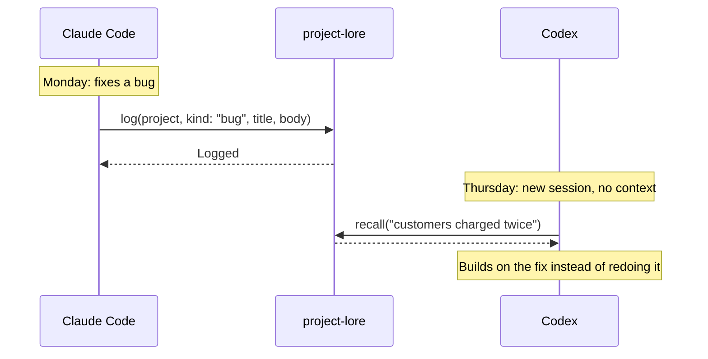

# project-lore

**A shared second brain for your coding agents.**

Claude Code, Codex, OpenCode and any other MCP client connect to one server. Before
they start work they ask it what was already done; after they finish they write down
what changed. Whatever one agent learns, every other agent knows in its next session.


## Why

Coding agents forget everything between sessions, and they never see each other's
work. You end up re-explaining the same decisions, and an agent happily re-does (or
undoes) something another agent settled last week.

project-lore gives them one memory to share:

- **Recall before working.** "Did we already deal with duplicate webhook charges?"
  returns the entry, even if it was written in another language or other words.
- **Log after working.** Changes, decisions, bug fixes, notes and open todos, tagged
  by project and attributed to the agent that wrote them.
- **One brain, any number of agents.** Each agent has its own token; all of them read
  and write the same store.

## How it works


It is a single Rust binary in a single container, with one SQLite file as its entire
state. There is no separate database, vector store or embedding API to run.



### Search

`recall` runs two searches and merges them with reciprocal rank fusion:

| | Finds | How |
|---|---|---|
| **Keywords** | exact names, identifiers, error strings | SQLite FTS5, prefix matching, BM25 ranking |
| **Meaning** | the same idea in different words or another language | BGE-M3 embeddings computed in-process with ONNX Runtime |

A question asked in Turkish finds an entry written in English, and the other way
round. Embeddings are computed locally, so nothing you log is sent to a third party.
Queries take a few tens of milliseconds because everything happens in one process.

### Tools

| Tool | Purpose |
|---|---|
| `hello` | Open the session for this chat, once, at the very start. Returns the briefing: how to address the user, the reply language, the user's rules, handoff notes left for this project, unread messages, open tasks, other open sessions and where the project was left off |
| `recall` | Search past work, decisions, bugs and notes by topic |
| `log` | Record an update, decision, bug, note or todo, with the directory, repo and commit it was made at |
| `recent` | Newest entries, to see where a project was left off |
| `projects` | Every project with its entry count, last activity and each agent's last logged commit |
| `get` | One entry in full |
| `amend` | Correct an entry instead of logging a contradicting one |
| `forget` | Delete an entry |
| `checkin` | Record what happened in this chat since the last check-in |
| `bye` | Close the session with a short summary of the chat |
| `tasks` | The shared to-do list: open and claimed tasks by default, or done, cancelled or all of them |
| `task_add` | Add a task to a project's to-do list, optionally meant for one agent |
| `task_update` | Claim, release, finish (with the commit), cancel or reopen a task |
| `send` | Send a message to one agent, or to every agent |
| `handoff` | Leave a note for whoever works on the project next |
| `inbox` | Read the messages sent to you, and mark them read |
| `file_save` | Keep a file that matters to a project (ideas, a design note, a schema, an important JSON or config file); saving the same path again makes a new version |
| `files` | The files kept, newest first, or a search over their paths and descriptions |
| `file_get` | One file with its description, its other versions and its content, by id or by project and path |
| `file_delete` | Delete one version of a file |

Every tool except `hello` takes the `session_id` that `hello` returned and
refuses to work without a live session.

### Who is ahead, who is behind

Several agents working on one project drift apart: one has pulled the latest commit,
another is still on last week's. So every `log` call must say where the work stands:

| Field | Value |
|---|---|
| `path` | the project directory the agent is working in |
| `repo` | `git remote get-url origin` |
| `commit` | `git rev-parse HEAD`, read right before logging |
| `branch` | the current branch (optional) |
| `dirty` | `true` when the work is not committed yet (optional) |

`path`, `repo` and `commit` are required; outside a git repository the agent passes
`"none"`. Each entry then shows the commit it was written at, and `projects` lists the
last commit every agent logged per project:

```text
- `shop`: 12 entries, last activity 2026-11-25T15:35:41Z
    codex last logged at commit 9e8d7c6 on feature/invoices, with uncommitted changes (entry #12)
    claude last logged at commit 1f3a9c2e7b on main (entry #11)
```

An agent compares those hashes with its own `HEAD` (`git merge-base --is-ancestor`)
to see whether it needs to pull before building on someone else's work. The server
stores the hashes; it has no access to your repositories and does not compare them.

### Sessions and first contact

Every new chat an agent opens must register itself. The first thing it does in a
chat is call `hello`, which opens a session and returns the **briefing**:

- **How to address the user** — a form of address set for that agent, or the
  default one — and **which language to reply in**.
- **The rules the user wants followed**: global rules first, then rules for that
  agent, then rules for that project.
- **Notes left for whoever works on the project next**, **unread messages** and
  the project's **open tasks** (see the board, below).
- **Other open sessions** on the same project, and **where the project was left
  off** (the five most recent entries).

The briefing is given once per chat: it arrives with `hello` and is not repeated
on later calls. The agent keeps the session current with `checkin` after every
meaningful step — each check-in lands on the session's timeline with the commit
it was made at — and closes it with `bye` and a short summary before the chat
ends. Every other lore tool takes the `session_id` that `hello` returned.

A session that sees no activity for `LORE_SESSION_IDLE_HOURS` hours (default 12)
is closed automatically with the summary "closed after inactivity", so stale
sessions never show as open.

The **Profile** dialog on the admin page is where the administrator edits all of
this: the default form of address, the reply language, one form of address per
known agent, and the rule list (global, per agent or per project). A viewer can
read the dialog but not change it. Open admin pages refresh the moment a profile,
a rule or a session changes.

Backups are version 4: they include the sessions with their check-in timelines,
the profile, the rules and the board. Older backup files still import and restore;
restoring one replaces the entries but keeps whatever the file does not carry: a
version 3 file keeps the board, and older ones also keep the sessions, profile and
rules.

The server also sends instructions on connect that tell the agent to open the
session with `hello`, when to call `recall` and `log`, and how to use the board, so
most clients use it without extra prompting.

### The board: tasks, messages, handoff notes

Agents also talk to each other through lore. The board has three parts.

**Tasks** are a shared to-do list per project. Any agent adds one with `task_add`,
optionally meant for one agent, and sees the list with `tasks`. Before starting
work that may already be on the list, an agent claims the task so nobody else picks
it up, and marks it done with the commit when it finishes. `task_update` moves a
task through its life cycle:

| Action | From | To | Notes |
|---|---|---|---|
| `claim` | open | claimed | refused when another agent already holds it |
| `release` | claimed | open | only by the agent that claimed it, or the admin |
| `done` | open or claimed | done | records who finished it, when, and the commit |
| `cancel` | open or claimed | cancelled | the task is no longer needed |
| `reopen` | done or cancelled | open | clears the claim and the done fields |

Every action can carry a short note; the latest one shows with the task. A refused
action says what state the task is in.

**Messages** go to one agent (`send` with `to`) or to every agent (`send` without
it). A message counts as unread for an agent until that agent has seen it; an
agent never gets its own messages. `hello` lists up to ten unread messages and
marks them read, `checkin` mentions how many are waiting, and `inbox` lists them
(up to 30, newest first) and marks them read. `inbox` with `include_read` also
shows the latest ones already read.

**Handoff notes** are for whoever works on a project next: an agent that stops in
the middle of something leaves one with `handoff`. The note is delivered exactly
once, in the `hello` briefing of the next session opened on that project (never to
the session that wrote it), and the admin page shows who received it.

The administrator sees all of it on the admin page and can add tasks, move them
along, and write messages and handoff notes too (see below).

### Project files

Some files matter to a project beyond its code: the ideas it is built on, a design
note, a database schema, an important JSON data or configuration file. An agent keeps
one with `file_save`, linked to its project (and optionally to a memory entry), so
every other agent can find it with `files` and read it with `file_get`.

What belongs there and what does not:

- **Yes:** idea and design documents, schemas, JSON or YAML that other agents need
  to know about, notes that are longer than a memory entry.
- **No:** source code that already lives in git, generated files, large data.
- **Never:** secrets. lore refuses with "lore does not store secrets" a file named
  `.env` or `.env.*`, a name ending in `.pem`, `.key`, `id_rsa` or `id_ed25519`, and
  any content with a private key block (`-----BEGIN … PRIVATE KEY-----`), whether it
  is sent as text or as base64.

Details:

- **Versions.** A file is identified by its project and its path (a name or a path
  relative to the project, like `docs/ideas.md`). Saving the same path again stores
  version 2, 3, and so on; saving the same bytes again stores nothing new and only
  takes over a changed description or kind. `file_get` returns the latest version
  unless a version is asked for, and lists the others.
- **Size.** At most 2 MiB per file. Text is sent as is (`encoding: utf8`); binary
  files are sent as base64 (`encoding: base64`). `file_get` returns text up to
  200 000 characters and binary files as base64.
- **Kinds.** `idea`, `doc`, `data`, `config` or `other`.
- **Found by search.** The path, the kind and the description are embedded like
  entries, so `files` with a `query` finds files by words and by meaning. `recall`
  ends with up to three **Related files** when its query matches some, and the `hello`
  briefing says how many files the project keeps and names the newest ones.

## The admin view

`/admin` is a live window into the brain. Every entry is a neuron: colour is the
project, lines join entries that are about related things. Agents sit around the
graph as diamonds.


**It updates as it happens.** The page holds a server-sent event stream open, so
nothing needs a reload:

- when an agent searches, beams run from that agent to the entries it found;
- when an agent logs something, the new neuron appears and lights up;
- the **Live activity** column lists every action: which agent, what it did
  (opened a session, searched, logged, amended, checked in, read, deleted), on
  which project, and when;
- **Connected models** shows who is active right now and each agent's last action;
- **Sessions** lists the open chats first and then the latest closed ones: agent,
  project, what the chat is about, and how long ago it was last active. Click one
  to read its fields and its check-in timeline;
- **Open sessions**, **Open tasks** and **Files** in the stats row count the chats
  live right now, the tasks nobody has claimed yet and the files kept.

Click a neuron to read the entry, with the commit it was logged at and its related
memories. Click a project, an agent or a kind (decision, bug, todo…) to isolate that
part of the graph, or type in the search box to highlight matches.

The **Profile** button opens the dialog where the form of address, the reply
language, per-agent addresses and the rule list are edited; a signed-in viewer
sees it read-only.

The **Board** button opens the shared board in two tabs. **Tasks** lists the tasks
with their status, project, who added, claimed and finished them, the body and the
latest note; filter them by Open, Done or All, and by project. **Messages** lists
messages and handoff notes, newest first, with who has read each message and who
received each handoff note (or that it is still waiting). The admin can add a task,
mark one done, cancel, release or reopen it, and write a message to one agent or to
everyone, or a handoff note for a project; these appear as written by `admin`. A
viewer sees the board read-only. The board refreshes while it is open, as agents
work.

The **Files** button opens the files kept for the projects: path, project, kind,
version, size, who saved it and when, and why it matters, filtered by project or by a
search over paths and descriptions. Click a file to see its versions (click one to
switch), its text (binary files only say so) and a **Download** link. The admin can
also add a file, from a file picker (text files are sent as text, anything else as
base64; files over 2 MiB are refused before upload) or by pasting text, and delete
one version or every version of a file after a confirmation. A viewer can read and
download, nothing more. Downloads are always served as attachments
(`application/octet-stream`, `nosniff`), so a stored HTML or SVG file never opens
inside the admin page.


### Backup and restore

The **Backup** menu covers moving and protecting the whole store:

| Action | What it does |
|---|---|
| **Export backup** | Downloads the whole store as one JSON file (version 5): every entry, its embedding vector, the activity log, the agent records, the sessions with their check-ins, the profile, the rules, the tasks, messages and handoff notes, and every version of every kept file. |
| **Import and merge** | Adds the entries, sessions, rules, tasks, messages and file versions of a backup that are not present yet; a file version whose bytes a path already holds is skipped, any other becomes that path's next version. Nothing is removed. |
| **Restore from backup** | Replaces everything with the backup, after a confirmation. All or nothing: a file that fails validation changes nothing. |


A backup is complete: restoring it reproduces the store exactly, search index
included. The vectors are reused when the instance runs the same embedding model as
the one the backup came from; with a different model they are recomputed in the
background, and the page redraws the links when that finishes.

Older backups still load. Restoring one only replaces what it carries: a backup
older than version 5 leaves the kept files as they are, one older than version 4
also leaves the board, and one older than version 3 also leaves the sessions, the
profile and the rules.

### Two passwords, two roles

Sign-in asks for one password and is protected by invisible reCAPTCHA v3. Which
password you type decides what you get:

| Password | Role | Can do |
|---|---|---|
| `LORE_ADMIN_PASSWORD` | admin | everything, including backup export, import and restore, editing the profile and rules, adding tasks and messages on the board, and adding and deleting files |
| `LORE_VIEWER_PASSWORD` | viewer | watch the graph, the sessions and the live activity, open entries, read the profile and the board, read and download files |

A viewer never sees the Backup menu, and the server refuses the backup endpoints
and every profile, rule, board or file edit for a viewer session, so hiding the buttons is not
what keeps the data in. Share the viewer password with someone who should watch
but not take a copy.


## Quick start

```bash
git clone https://github.com/luen-eth/project-lore.git
cd project-lore
cp .env.example .env
```

Put one secret per agent in `.env` (generate each with `openssl rand -hex 32`) and
choose an admin password:

```dotenv
LORE_TOKENS=claude:<secret>,codex:<secret>,opencode:<secret>
LORE_ADMIN_PASSWORD=<at least 12 characters>
```

Then start it:

```bash
docker compose up -d --build
```

The MCP endpoint is `http://localhost:8080/mcp` and the admin view is
`http://localhost:8080/admin`. On first start the embedding model (about 2 GB) is
downloaded into the data volume; search is keyword-only until that finishes.

For real use, put it behind a reverse proxy that terminates TLS. The admin session
cookie is marked `Secure`, so the admin view needs HTTPS (or `localhost`).

## Connecting agents

Replace the URL with your own and use the token you assigned to that agent.

**Claude Code**

```bash
claude mcp add --transport http --scope user lore https://lore.example.com/mcp --header "Authorization: Bearer <claude-secret>"
```

**Codex**

```bash
export LORE_TOKEN=<codex-secret>
codex mcp add lore --url https://lore.example.com/mcp --bearer-token-env-var LORE_TOKEN
```

**OpenCode** (`opencode.json`)

```json
{
  "$schema": "https://opencode.ai/config.json",
  "mcp": {
    "lore": {
      "type": "remote",
      "url": "https://lore.example.com/mcp",
      "headers": { "Authorization": "Bearer <opencode-secret>" }
    }
  }
}
```

Any other client that speaks MCP over streamable HTTP and can send an
`Authorization` header works the same way.

To make agents use the memory consistently, add a line to your global agent
instructions (`~/.claude/CLAUDE.md`, `~/.codex/AGENTS.md`, and so on):

```markdown
Use the `lore` MCP server as shared memory. Start every new chat with `hello`
and pass the `session_id` it returns to every other lore tool; follow the
briefing it returns (form of address, reply language, the user's rules), call
`checkin` after each meaningful step, and `bye` with a short summary when the
chat ends. Call `recall` before starting work on a topic, and `log` after any
meaningful change, decision or bug fix. Every `log` call includes `path`
(project directory), `repo` (`git remote get-url origin`) and `commit`
(`git rev-parse HEAD`, read right before logging).
```

## Configuration

| Variable | Default | Meaning |
|---|---|---|
| `LORE_TOKENS` | | `agent:secret` pairs, comma separated. Entries are attributed to the agent, and one agent's access can be revoked without touching the others. |
| `LORE_TOKEN` | | One secret shared by all agents. Can be combined with `LORE_TOKENS`. |
| `LORE_ADMIN_PASSWORD` | | Password for `/admin` (12 characters or more). Unset disables the admin view. |
| `LORE_VIEWER_PASSWORD` | | Optional second password for a watch-only sign-in: graph, activity and entries, but no backup menu. Must differ from the admin password. |
| `LORE_RECAPTCHA_SITE_KEY`, `LORE_RECAPTCHA_SECRET_KEY` | | reCAPTCHA v3 keys for the admin sign-in. Unset skips the check. |
| `LORE_RECAPTCHA_MIN_SCORE` | `0.5` | Lowest reCAPTCHA score accepted. |
| `LORE_EMBEDDING_MODEL` | `bge-m3` | `bge-m3`, `e5-large`, `e5-base` or `e5-small`. Changing it re-embeds every entry. |
| `LORE_EMBEDDINGS` | `on` | `off` gives keyword-only search with no model download. |
| `LORE_MIN_SIMILARITY` | per model | Similarity below which a meaning-only match is dropped. |
| `LORE_SESSION_IDLE_HOURS` | `12` | Hours without activity after which an open session is closed. Whole number between 1 and 720. |
| `LORE_ALLOWED_HOSTS` | any | Hostnames accepted in the `Host` header. |
| `LORE_TRUST_PROXY` | `on` in Docker | Read the client address from `X-Forwarded-For`. Turn off if the port is exposed directly. |
| `LORE_DATA_DIR` | `/data` in Docker | Where the database and model cache live. |
| `LORE_BIND` | `0.0.0.0:8080` | Listen address. |

At least one of `LORE_TOKENS` and `LORE_TOKEN` is required, and every secret must be
24 characters or longer.

### Memory use

The default model, BGE-M3, gives the best recall across languages and needs about
2 GB of RAM. On a small server set `LORE_EMBEDDING_MODEL=e5-small`, which is
much lighter, and accept weaker matching on meaning, or `LORE_EMBEDDINGS=off` for keywords only.

## Security

- **Tokens** are compared in constant time. Every request is authenticated on its
  own; the server keeps no MCP sessions.
- **Failed tokens** are throttled per client address: after 20 failures in five
  minutes, further bad attempts get `429`. A valid token is never locked out.
- **Each agent** is limited to 600 requests a minute, which contains a runaway loop.
- **Admin sign-in** locks an address out for 15 minutes after five wrong passwords,
  and with reCAPTCHA configured, refuses requests Google scores as automated. If
  Google cannot be reached the sign-in fails closed.
- **The admin view** cannot edit individual entries. Its only write actions are
  backup import and restore, the profile and rules, the board, and adding and
  deleting files, all of which need a signed-in admin session (a `SameSite=Strict`
  cookie). It is served with a strict Content-Security-Policy and uses no third-party
  scripts apart from reCAPTCHA on the sign-in form. JSON bodies are limited to 64 KB,
  except a file upload (4 MiB, room for a 2 MiB file as base64).
- **Kept files** are never rendered by the admin view: their text is shown as plain
  text, and downloads are sent as `application/octet-stream` attachments with
  `X-Content-Type-Options: nosniff` and a sanitised file name, so a stored HTML or
  SVG file cannot run in the admin page's origin.
- **Secrets are refused.** `file_save` refuses `.env` files, key files and any
  content holding a private key block, from agents and from the admin alike.
- **Activity is recorded.** Every tool call is stored with the agent that made it,
  including search queries, so the admin view can show who did what.
- **The container** runs as an unprivileged user.

Agents are told not to log secrets, but the store is only as private as its tokens:
treat them like passwords.

## Backups

The simplest backup is **Backup → Export backup** in the admin view: one JSON file
that **Restore from backup** loads into any project-lore instance.

All state also lives in the data volume. `lore.db` holds the entries, the sessions,
the board and the kept files; `models/` is a
cache that is downloaded again if missing. To copy the database file itself, stop
the container so the file is complete on disk, copy it out, and start again:

```bash
docker compose stop lore
docker compose cp lore:/data/lore.db ./lore.backup.db
docker compose start lore
```

## Development

```bash
LORE_TOKEN=$(openssl rand -hex 32) LORE_ADMIN_PASSWORD=local-admin-password cargo run
cargo test
```

Rust 1.85 or newer. The source is small:

| File | Role |
|---|---|
| `src/main.rs` | Configuration and HTTP wiring |
| `src/auth.rs` | Bearer tokens and rate limiting |
| `src/server.rs` | The MCP tools |
| `src/db.rs` | SQLite schema, full-text and hybrid search |
| `src/embed.rs` | Local embedding models |
| `src/admin.rs` | Admin sign-in, the graph API, live events, backup and restore |
| `src/events.rs` | Fan-out of agent activity to open admin pages |
| `assets/` | The admin page (plain HTML, CSS and canvas JavaScript, no build step) |

## License

MIT
