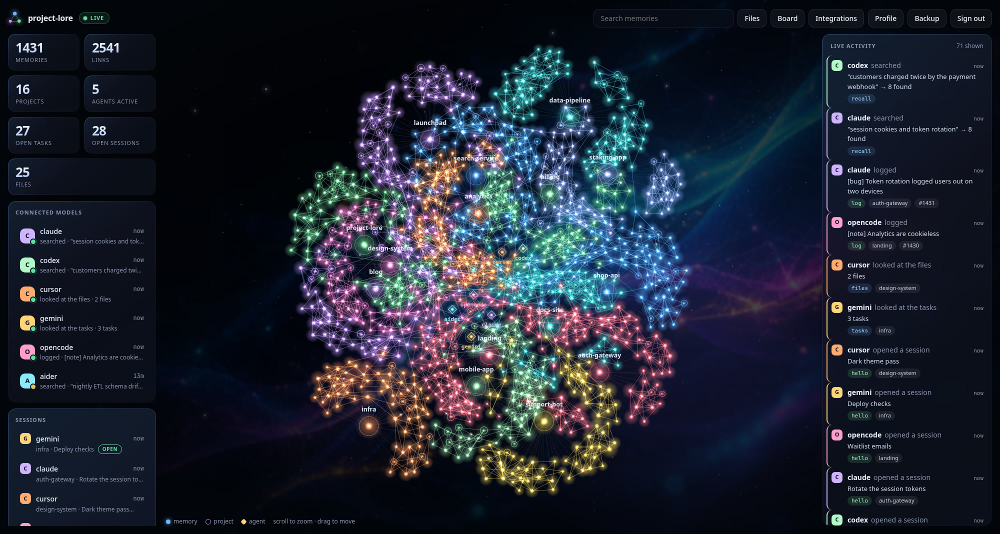
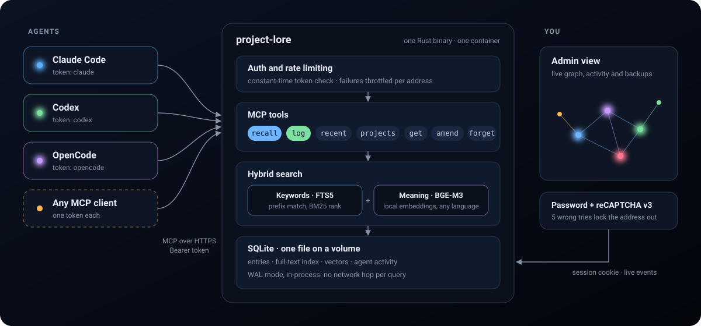
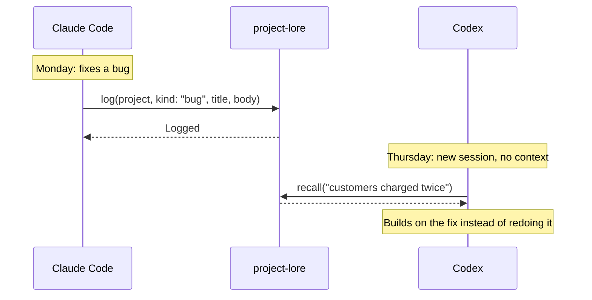
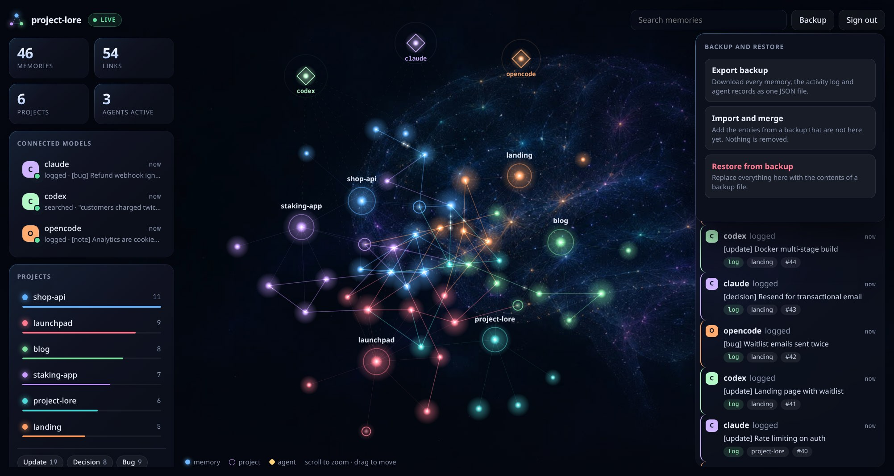

# project-lore

**A shared second brain for your coding agents.**

Claude Code, Codex, OpenCode and any other MCP client connect to one server. Before
they start work they ask it what was already done; after they finish they write down
what changed. Whatever one agent learns, every other agent knows in its next session.



## Why

Coding agents forget everything between sessions, and they never see each other's
work. You end up re-explaining the same decisions, and an agent happily re-does (or
undoes) something another agent settled last week.

project-lore gives them one memory to share:

- **Recall before working.** "Did we already deal with duplicate webhook charges?"
  returns the entry, even if it was written in another language or other words.
- **Log after working.** Changes, decisions, bug fixes, notes and open todos, tagged
  by project and attributed to the agent that wrote them.
- **One brain, any number of agents.** Each agent has its own token; all of them read
  and write the same store.

## How it works



It is a single Rust binary in a single container, with one SQLite file as its entire
state. There is no separate database, vector store or embedding API to run.



### Search

`recall` runs two searches and merges them with reciprocal rank fusion:

| | Finds | How |
|---|---|---|
| **Keywords** | exact names, identifiers, error strings | SQLite FTS5, prefix matching, BM25 ranking |
| **Meaning** | the same idea in different words or another language | BGE-M3 embeddings computed in-process with ONNX Runtime |

A question asked in Turkish finds an entry written in English, and the other way
round. Embeddings are computed locally, so nothing you log is sent to a third party.
Queries take a few tens of milliseconds because everything happens in one process.

### Tools

| Tool | Purpose |
|---|---|
| `recall` | Search past work, decisions, bugs and notes by topic |
| `log` | Record an update, decision, bug, note or todo, with the directory, repo and commit it was made at |
| `recent` | Newest entries, to see where a project was left off |
| `projects` | Every project with its entry count, last activity and each agent's last logged commit |
| `get` | One entry in full |
| `amend` | Correct an entry instead of logging a contradicting one |
| `forget` | Delete an entry |

### Who is ahead, who is behind

Several agents working on one project drift apart: one has pulled the latest commit,
another is still on last week's. So every `log` call must say where the work stands:

| Field | Value |
|---|---|
| `path` | the project directory the agent is working in |
| `repo` | `git remote get-url origin` |
| `commit` | `git rev-parse HEAD`, read right before logging |
| `branch` | the current branch (optional) |
| `dirty` | `true` when the work is not committed yet (optional) |

`path`, `repo` and `commit` are required; outside a git repository the agent passes
`"none"`. Each entry then shows the commit it was written at, and `projects` lists the
last commit every agent logged per project:

```text
- `shop`: 12 entries, last activity 2026-11-25T15:35:41Z
    codex last logged at commit 9e8d7c6 on feature/invoices, with uncommitted changes (entry #12)
    claude last logged at commit 1f3a9c2e7b on main (entry #11)
```

An agent compares those hashes with its own `HEAD` (`git merge-base --is-ancestor`)
to see whether it needs to pull before building on someone else's work. The server
stores the hashes; it has no access to your repositories and does not compare them.

The server also sends instructions on connect that tell the agent when to call
`recall` and `log`, so most clients use it without extra prompting.

## The admin view

`/admin` is a live window into the brain. Every entry is a neuron: colour is the
project, lines join entries that are about related things. Agents sit around the
graph as diamonds.


**It updates as it happens.** The page holds a server-sent event stream open, so
nothing needs a reload:

- when an agent searches, beams run from that agent to the entries it found;
- when an agent logs something, the new neuron appears and lights up;
- the **Live activity** column lists every action: which agent, what it did
  (searched, logged, amended, read, deleted), on which project, and when;
- **Connected models** shows who is active right now and each agent's last action.

Click a neuron to read the entry, with the commit it was logged at and its related
memories. Click a project, an agent or a kind (decision, bug, todo…) to isolate that
part of the graph, or type in the search box to highlight matches.


### Backup and restore

The **Backup** menu covers moving and protecting the whole store:

| Action | What it does |
|---|---|
| **Export backup** | Downloads the whole store as one JSON file: every entry, its embedding vector, the activity log and the agent records. |
| **Import and merge** | Adds the entries of a backup that are not present yet. Nothing is removed. |
| **Restore from backup** | Replaces everything with the backup, after a confirmation. All or nothing: a file that fails validation changes nothing. |



A backup is complete: restoring it reproduces the store exactly, search index
included. The vectors are reused when the instance runs the same embedding model as
the one the backup came from; with a different model they are recomputed in the
background, and the page redraws the links when that finishes.

Sign-in asks for one password and is protected by invisible reCAPTCHA v3.


## Quick start

```bash
git clone https://github.com/luen-eth/project-lore.git
cd project-lore
cp .env.example .env
```

Put one secret per agent in `.env` (generate each with `openssl rand -hex 32`) and
choose an admin password:

```dotenv
LORE_TOKENS=claude:<secret>,codex:<secret>,opencode:<secret>
LORE_ADMIN_PASSWORD=<at least 12 characters>
```

Then start it:

```bash
docker compose up -d --build
```

The MCP endpoint is `http://localhost:8080/mcp` and the admin view is
`http://localhost:8080/admin`. On first start the embedding model (about 2 GB) is
downloaded into the data volume; search is keyword-only until that finishes.

For real use, put it behind a reverse proxy that terminates TLS. The admin session
cookie is marked `Secure`, so the admin view needs HTTPS (or `localhost`).

## Connecting agents

Replace the URL with your own and use the token you assigned to that agent.

**Claude Code**

```bash
claude mcp add --transport http --scope user lore https://lore.example.com/mcp --header "Authorization: Bearer <claude-secret>"
```

**Codex**

```bash
export LORE_TOKEN=<codex-secret>
codex mcp add lore --url https://lore.example.com/mcp --bearer-token-env-var LORE_TOKEN
```

**OpenCode** (`opencode.json`)

```json
{
  "$schema": "https://opencode.ai/config.json",
  "mcp": {
    "lore": {
      "type": "remote",
      "url": "https://lore.example.com/mcp",
      "headers": { "Authorization": "Bearer <opencode-secret>" }
    }
  }
}
```

Any other client that speaks MCP over streamable HTTP and can send an
`Authorization` header works the same way.

To make agents use the memory consistently, add a line to your global agent
instructions (`~/.claude/CLAUDE.md`, `~/.codex/AGENTS.md`, and so on):

```markdown
Use the `lore` MCP server as shared memory: call `recall` before starting work on a
topic, and `log` after any meaningful change, decision or bug fix. Every `log` call
includes `path` (project directory), `repo` (`git remote get-url origin`) and `commit`
(`git rev-parse HEAD`, read right before logging).
```

## Configuration

| Variable | Default | Meaning |
|---|---|---|
| `LORE_TOKENS` | | `agent:secret` pairs, comma separated. Entries are attributed to the agent, and one agent's access can be revoked without touching the others. |
| `LORE_TOKEN` | | One secret shared by all agents. Can be combined with `LORE_TOKENS`. |
| `LORE_ADMIN_PASSWORD` | | Password for `/admin` (12 characters or more). Unset disables the admin view. |
| `LORE_RECAPTCHA_SITE_KEY`, `LORE_RECAPTCHA_SECRET_KEY` | | reCAPTCHA v3 keys for the admin sign-in. Unset skips the check. |
| `LORE_RECAPTCHA_MIN_SCORE` | `0.5` | Lowest reCAPTCHA score accepted. |
| `LORE_EMBEDDING_MODEL` | `bge-m3` | `bge-m3`, `e5-large`, `e5-base` or `e5-small`. Changing it re-embeds every entry. |
| `LORE_EMBEDDINGS` | `on` | `off` gives keyword-only search with no model download. |
| `LORE_MIN_SIMILARITY` | per model | Similarity below which a meaning-only match is dropped. |
| `LORE_ALLOWED_HOSTS` | any | Hostnames accepted in the `Host` header. |
| `LORE_TRUST_PROXY` | `on` in Docker | Read the client address from `X-Forwarded-For`. Turn off if the port is exposed directly. |
| `LORE_DATA_DIR` | `/data` in Docker | Where the database and model cache live. |
| `LORE_BIND` | `0.0.0.0:8080` | Listen address. |

At least one of `LORE_TOKENS` and `LORE_TOKEN` is required, and every secret must be
24 characters or longer.

### Memory use

The default model, BGE-M3, gives the best recall across languages and needs about
2 GB of RAM. On a small server set `LORE_EMBEDDING_MODEL=e5-small`, which is
much lighter, and accept weaker matching on meaning, or `LORE_EMBEDDINGS=off` for keywords only.

## Security

- **Tokens** are compared in constant time. Every request is authenticated on its
  own; the server keeps no MCP sessions.
- **Failed tokens** are throttled per client address: after 20 failures in five
  minutes, further bad attempts get `429`. A valid token is never locked out.
- **Each agent** is limited to 600 requests a minute, which contains a runaway loop.
- **Admin sign-in** locks an address out for 15 minutes after five wrong passwords,
  and with reCAPTCHA configured, refuses requests Google scores as automated. If
  Google cannot be reached the sign-in fails closed.
- **The admin view** cannot edit individual entries. Its only write actions are
  backup import and restore, which need the signed-in session (a `SameSite=Strict`
  cookie). It is served with a strict Content-Security-Policy and uses no third-party
  scripts apart from reCAPTCHA on the sign-in form.
- **Activity is recorded.** Every tool call is stored with the agent that made it,
  including search queries, so the admin view can show who did what.
- **The container** runs as an unprivileged user.

Agents are told not to log secrets, but the store is only as private as its tokens:
treat them like passwords.

## Backups

The simplest backup is **Backup → Export backup** in the admin view: one JSON file
that **Restore from backup** loads into any project-lore instance.

All state also lives in the data volume. `lore.db` holds the entries; `models/` is a
cache that is downloaded again if missing. To copy the database file itself, stop
the container so the file is complete on disk, copy it out, and start again:

```bash
docker compose stop lore
docker compose cp lore:/data/lore.db ./lore.backup.db
docker compose start lore
```

## Development

```bash
LORE_TOKEN=$(openssl rand -hex 32) LORE_ADMIN_PASSWORD=local-admin-password cargo run
cargo test
```

Rust 1.85 or newer. The source is small:

| File | Role |
|---|---|
| `src/main.rs` | Configuration and HTTP wiring |
| `src/auth.rs` | Bearer tokens and rate limiting |
| `src/server.rs` | The MCP tools |
| `src/db.rs` | SQLite schema, full-text and hybrid search |
| `src/embed.rs` | Local embedding models |
| `src/admin.rs` | Admin sign-in, the graph API, live events, backup and restore |
| `src/events.rs` | Fan-out of agent activity to open admin pages |
| `assets/` | The admin page (plain HTML, CSS and canvas JavaScript, no build step) |

## License

MIT
